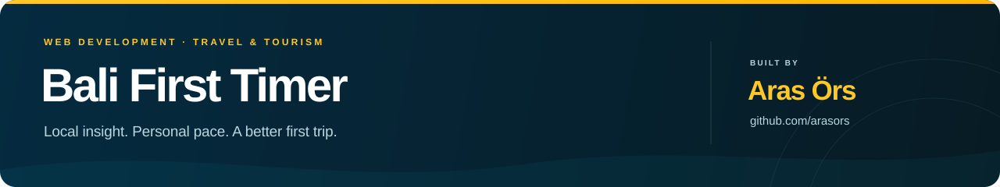
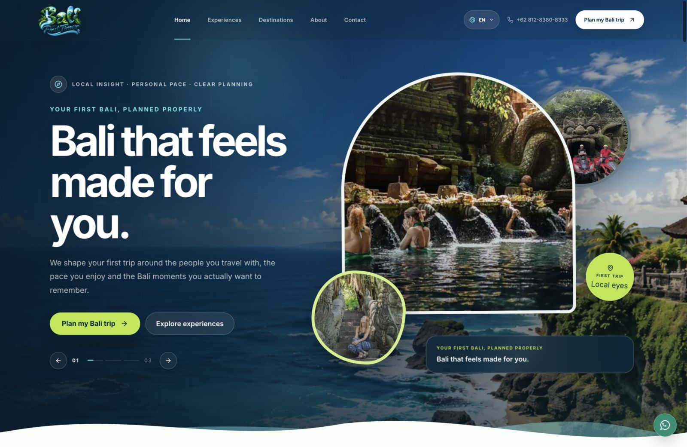
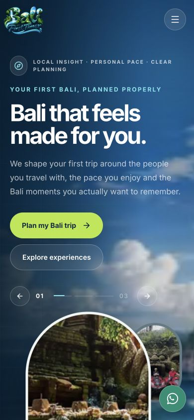

<p align="center">
  
</p>

<p align="center">
  A multilingual website for discovering Bali, planning personal itineraries<br />
  and turning a travel wish list into a conversation with a local team.
</p>

<p align="center">
  <a href="https://bali-first-timer.vercel.app/"><strong>Live preview ↗</strong></a>
  &nbsp;·&nbsp;
  <a href="#the-project">The project</a>
  &nbsp;·&nbsp;
  <a href="#features">Features</a>
  &nbsp;·&nbsp;
  <a href="#run-locally">Run locally</a>
  &nbsp;·&nbsp;
  <a href="#built-by">Get in touch</a>
</p>

<p align="center">
  <a href="https://bali-first-timer.vercel.app/">
    
  </a>
</p>

<p align="center">
  <sub>Header and hero captured from the deployed website. Select the preview to explore the live experience.</sub>
</p>

<p align="center">
  <code>Next.js 16</code>&nbsp;
  <code>React 19</code>&nbsp;
  <code>TypeScript</code>&nbsp;
  <code>Tailwind CSS 4</code>&nbsp;
  <code>Lenis</code>
</p>

## The project

Bali First Timer helps first-time visitors discover the island through personal
itineraries, waterfall trips, food experiences and local recommendations. This
website brings those services together in a visual, mobile-friendly experience
with a direct path to WhatsApp trip planning.

The implementation covers the landing page, destination and company pages,
12 experience pages, five interface languages, an interactive trip planner,
search metadata and a complete set of sharing and application icons.

## Features

| Area | What is included |
| :--- | :--- |
| **First impression** | Transparent navigation, a branded splash screen, a rotating hero and layered photography over a Bali coastline backdrop. |
| **Motion** | Lenis smooth scrolling, scroll-linked waves, pointer-responsive image layers, magnetic buttons and reversible reveal and text-colour effects. |
| **Languages** | English, Russian, French, German and Arabic, with browser-language detection, an English fallback, saved preferences and Arabic RTL layout. |
| **Trip planning** | Visitors choose their trip length, travel group and interests, then send the starting plan to WhatsApp in their selected language. |
| **Content** | 17 pages covering the business, destinations and experiences such as waterfalls, temples, local food, beaches and family trips. |
| **Search & sharing** | Page metadata, canonical URLs, sitemap, robots, structured data, LLM text files and 17 branded Open Graph / Twitter cards. |
| **Device support** | Responsive layouts, a full-screen mobile menu, SVG and ICO favicons, Apple touch icons and Android icons with a maskable variant. |
| **Configuration** | Environment-driven contact details, site URL, analytics, tag management, pixel and search-verification settings. |

Motion uses a shared animation loop and viewport observers. Hero animation pauses
off screen, native touch scrolling is preserved, and effects adapt to the
visitor's reduced-motion preference.

<details>
  <summary><strong>View the mobile preview</strong></summary>
  <br />
  <p align="center">
    
  </p>
</details>

## Technology

| Layer | Tools |
| :--- | :--- |
| Application | Next.js App Router, React and strict TypeScript |
| Interface | Tailwind CSS, Lucide icons and reusable page sections |
| Interaction | Lenis, IntersectionObserver, ResizeObserver and CSS animation |
| Brand assets | An editable SVG favicon master and Sharp-generated social cards and icon exports |
| Delivery | Vercel, with GitHub Actions for lint, type checking and production builds |

## Run locally

Use **Node.js 24.x** and **Bun 1.4.0 or later**.

```bash
git clone https://github.com/arasors/bali-first-timer.git
cd bali-first-timer
bun install --frozen-lockfile
cp .env.example .env.local
bun run dev
```

Open [localhost:3000](http://localhost:3000). Contact, analytics and verification
settings are documented in [`.env.example`](./.env.example).

| Command | Purpose |
| :--- | :--- |
| `bun run dev` | Start the development server |
| `bun run check` | Run lint, TypeScript checks and the production build |
| `bun run build` | Create a production build |
| `bun run start` | Serve the production build |
| `bun run brand:assets` | Regenerate social cards, favicons and application icons |

<details>
  <summary><strong>Configuration and project structure</strong></summary>

### Configuration

- **Site and contact:** production URL, business location, phone and WhatsApp details.
- **Analytics:** Google Analytics 4, Google Tag Manager, Yandex Metrica and Meta Pixel.
- **Verification:** Google, Yandex and Bing verification tokens.

Analytics integrations are enabled through their environment settings. Variables
prefixed with `NEXT_PUBLIC_` are visible to the browser; keep private credentials
out of them.

### Structure

```text
src/app/                  Routes, metadata, sitemap and LLM files
src/components/i18n/      Language selection, translations and splash screen
src/components/motion/    Shared motion controller and scroll-colour text
src/components/sites/     Page sections, reusable inner pages and content
src/components/analytics/ Optional tracking integrations
public/seo/               Favicon master and generated social cards
scripts/                  Asset-generation utilities
docs/readme/              Project header and live website screenshots
```

</details>

<details>
  <summary><strong>Maintaining the project showcase</strong></summary>

- After changing the logo, hero backdrop, page copy or production domain, run
  `bun run brand:assets` and include the generated assets with the source changes.
- The favicon master is [`public/seo/brand-mark.svg`](./public/seo/brand-mark.svg).
  Social cards are saved under [`public/seo/og/`](./public/seo/og/).
- Refresh the real website screenshots when the header or hero changes. The
  current captures use the English homepage at 1600×1040 and 390×844.
- Keep the project introduction, feature descriptions and live-demo link aligned
  with what is actually shipped.

The [project README guide](./docs/PROJECT_README_GUIDE.md) records the same format
for other public repositories.

</details>

## Built by

**[Aras Örs](https://github.com/arasors)** · Full stack engineer and founder of
[SENTROY](https://sentroy.com/).

For a website, a product build or an application that needs to move forward,
connect on [LinkedIn](https://www.linkedin.com/in/arasors/) or
[Upwork](https://www.upwork.com/freelancers/~01ee3382ccf6d07f2e).

<p align="center">
  <sub>Built by <a href="https://github.com/arasors">Aras Örs</a> · <a href="./LICENSE">MIT license</a></sub>
</p>
